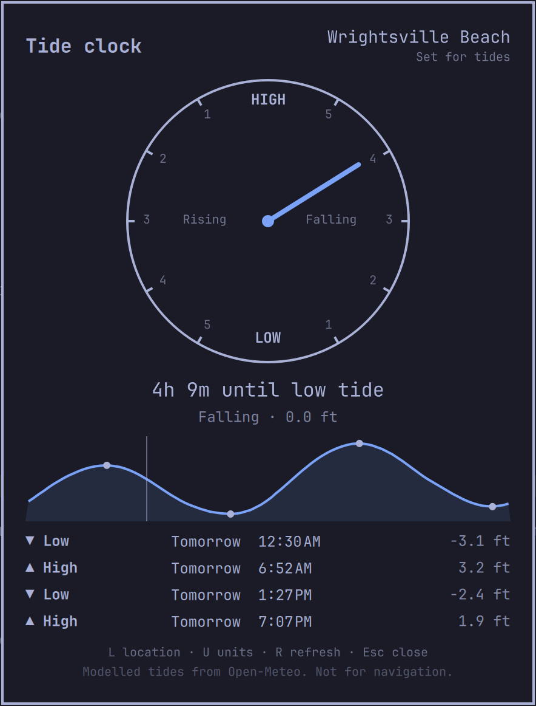

# Tide clock for Omarchy

A tide clock that pops up in the middle of your screen with one keystroke. It shows where the tide is right now, how long until the next high or low, a 24-hour tide curve, and the next four tides for your location.



## Install

```bash
omarchy plugin add https://github.com/cburnette/omarchy-tides.git --enable
```

Then add a shortcut to `~/.config/hypr/bindings.lua`:

```lua
o.bind("SUPER + ALT + T", "Tide clock", { panel = "cburnette.tides" })
```

Super + Alt + T is free on a stock Omarchy install. If you already use it, choose another key. Hyprland reloads the file when you save it.

You can also open it from a terminal or script:

```bash
omarchy-shell shell toggle cburnette.tides
```

## Use

| Key | Action |
|---|---|
| **L** (or click the place name) | Search for a location. Use ↑↓ to choose and Enter to save. |
| **U** | Switch between feet and meters |
| **R** | Refresh the tide data |
| **Esc** | Close the popup |

How to read the clock: HIGH is at the top and LOW is at the bottom. The hand moves down the right side while the tide falls and back up the left side while it rises. The small numbers count down the hours to the next tide.

## Location

The plugin chooses a location in this order:

1. A place you picked in the tide clock (press **L**)
2. The location set in Omarchy's weather widget
3. Your approximate location from your network, looked up through Omarchy's own `geo.omarchy.org` service, the same one the weather widget uses

Pick **Detect my location automatically** in the search view to go back to auto-detect. Your choice and unit preference are saved in `~/.local/state/omarchy/settings/tides.json`.

Inland locations have no ocean data. The popup says so and asks you to pick a coastal town.

## Data and privacy

- Tide data comes from the [Open-Meteo Marine API](https://open-meteo.com/en/docs/marine-weather-api). It's free and doesn't need an API key.
- The plugin goes online only when you open it and the data is more than 30 minutes old, or when you change location. It never runs in the background.
- The requests contain your coordinates (to Open-Meteo), your search text (to Open-Meteo's geocoding service), and, only when no location is set, a request to `geo.omarchy.org`.

**These are modelled tides, not official harbor predictions.** Times can be off by several minutes and heights by a fair amount. Don't use them for navigation or safety decisions. For that, use your national tide authority, such as NOAA in the US.

## Development

```bash
node --test tests/
```

The tide math is in `Model.js` (plain JavaScript, tested with node), and the popup is in `Tides.qml`. Saving any file reloads the plugin in the running shell. To add a translation, put a new `i18n/<language>.json` file next to `i18n/en.json`.

## License

MIT
